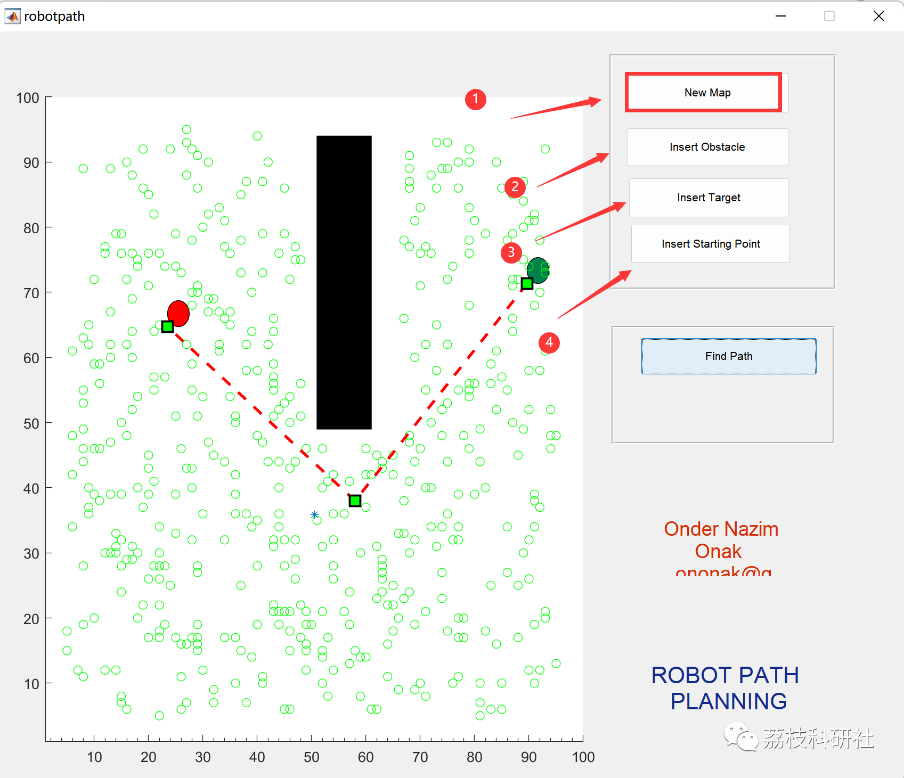

# Robot Path Planning Based on Artificial Bee Colony Optimization Algorithm (Matlab Code Implementation)

1. Overview
In recent years, mobile robot technology has received widespread attention both domestically and internationally, being considered one of the most important technological inventions in nearly a century, playing a significant role in economic and social development. Nowadays, mobile robots have been involved in various fields of human life, including industrial, agricultural, service industry, space exploration, and medical rehabilitation, etc. Path planning technology is a key and core technology in the field of mobile robots, serving as an important indicator for robots to complete tasks, reach their goals, and achieve higher levels of intelligence. It is also one of the most crucial modules in robot navigation. The path planning problem refers to finding an optimal or near-optimal safe path from the starting point to the target point based on some optimization strategy and constraints within the mobile space. How to plan a smooth and obstacle-avoiding efficient path is a highly challenging research topic.
2. Running Results
You can set your own obstacles, targets, and start points.
3. MATLAB Code Implementation
%% Start robot path finding procedure
function pushbutton4_Callback(hObject, eventdata, handles)
map = getappdata(0,'map');
target = getappdata(0,'target');
current_pos = getappdata(0,'current_pos');
if(target == [-1 -1])
msgbox('Please select the target position first');
elseif(current_pos(:,1) == [-1 ;-1])
msgbox('Please select the start position first');
else
end
%% Find Coolision free path using Artificial Bee Colony Algorithm  
Vxy = Create_Food_Points(map, target, 500,5,95 );  
hold on  
plot(Vxy(:,1),Vxy(:,2), 'go')  
pause(1)  
refresh  
abc_plot_handle = [];  
for i = 1:50  
[m n] = size(current_pos);  
[cost pos] = artificial_bee_colony(map, Vxy);  
current_pos(:,n+1) = pos.Position';  
setappdata(0,'current_pos',current_pos);  
hold on  
abc_plot_handle(i) = plot(current_pos(1,:),current_pos(2,:),'--rs','LineWidth',2,...  
'MarkerEdgeColor','k',...  
'MarkerFaceColor','g',...  
'MarkerSize',10)  
pause(2)  
if ((cost < 5))  
[M N] =size(map)  
collide = 0;  
for i=1:M  
collide = is_collide( map(i,:), current_pos(:,n+1), target');  
if collide == 1  
break;  
end  
end  
if(collide == 0)  
break;  
end  
end  
end  
[m n] = size(current_pos);  
post = [current_pos(n) current_pos(n) 4 4];  
hold on  
plot(current_pos(1,:),current_pos(2,:),'*')  
%% Optimize path usin EP algorithm  
for i = 1:20  
current_pos = ep_algorithm( map, current_pos );  
end  
delete(abc_plot_handle);  
plot(current_pos(1,:),current_pos(2,:),'--rs','LineWidth',2,...  
'MarkerEdgeColor','k',...  
'MarkerFaceColor','g',...  
'MarkerSize',10)  
pause(2)  
end  
Click the "Read More" button at the bottom left corner of this article to view the complete Matlab code.
Or reply with the keyword: Robot Path Planning Based on Artificial Bee Colony Optimization Algorithm
4. References
[1] Liu Jingsen, Yuan Mengmeng, Li Yu. Solution of Robot Path Planning Problems Based on an Improved Convex Hull Particle Swarm Optimization Algorithm [J]. Computer Research and Development, 2022, 59(6): 1297-1314

## Images

<!-- PAYMENT_BLOCK -->

## Get this dataset

- Payment link (Stripe): [Buy now](https://buy.stripe.com/3cs8yP7sY87d0vu9AB)
- Payment QR code: 

<!-- /PAYMENT_BLOCK -->
